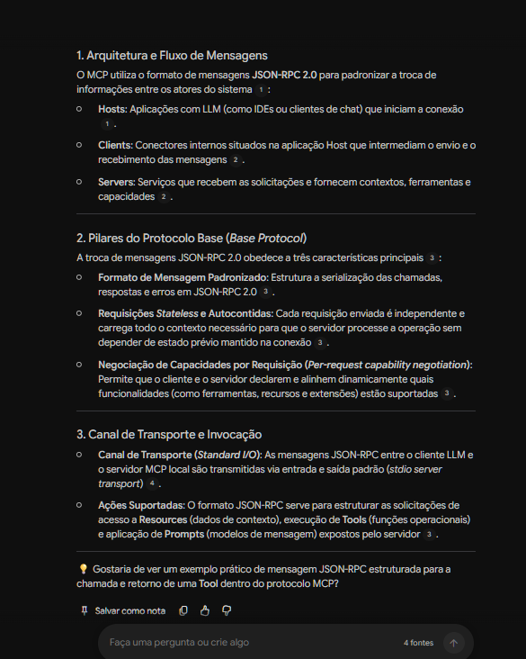
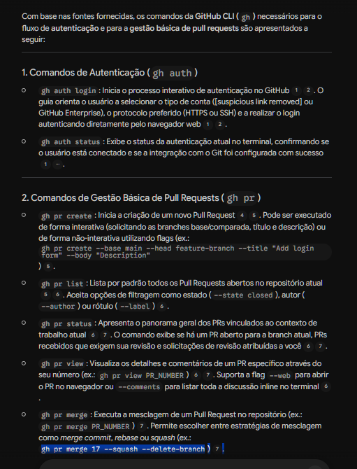

# Segundo Cérebro: Integração MCP e GitHub CLI

## Objetivo
Criar uma base de conhecimento consultiva sobre arquitetura de integração e scripts de automação entre o Model Context Protocol (MCP) e o GitHub CLI.

## Fontes Utilizadas
* **Model Context Protocol Specification**: Documentação oficial e técnica abordando JSON-RPC e extensões.
* **GitHub CLI Tutorial (Codecademy)**: Guia completo para comandos práticos do gh.
* **Get Started With The Model Context Protocol (YouTube)**: Tutorial prático de implementação de servidor.
* **How to install GitHub CLI and authenticate (YouTube)**: Guia visual de configuração e autenticação para repositórios.
* **Justificativa:** Fontes selecionadas pela precisão técnica, combinando documentação oficial e demonstrações práticas executáveis.

## Diretriz de Comportamento
"Atue como um Engenheiro de Software especialista em automação e integração de sistemas. Suas respostas devem ser baseadas exclusivamente nas documentações e scripts fornecidos nas fontes. Priorize comandos de terminal, estruturas de dados e arquitetura de integração. Indique explicitamente quando os dados disponíveis forem insuficientes para uma resposta."

## Interações e Evidências
**Pergunta 1:** Com base nas fontes, como o Model Context Protocol (MCP) utiliza mensagens JSON-RPC para estabelecer comunicação entre Hosts e Servers?

<b>Clique para ler a resposta completa gerada pelo Notebook</b>

### 1\. Arquitetura e Fluxo de Mensagens

O MCP utiliza o formato de mensagens **JSON-RPC 2.0** para padronizar a troca de informações entre os atores do sistema[1]:

* **Hosts**: Aplicações com LLM (como IDEs ou clientes de chat) que iniciam a conexão[1].
* **Clients**: Conectores internos situados na aplicação Host que intermediam o envio e o recebimento das mensagens[2].
* **Servers**: Serviços que recebem as solicitações e fornecem contextos, ferramentas e capacidades[2].

---

### 2\. Pilares do Protocolo Base (*Base Protocol*)

A troca de mensagens JSON-RPC 2.0 obedece a três características principais[3]:

* **Formato de Mensagem Padronizado**: Estrutura a serialização das chamadas, respostas e erros em JSON-RPC 2.0[3].
* **Requisições** **Stateless** **e Autocontidas**: Cada requisição enviada é independente e carrega todo o contexto necessário para que o servidor processe a operação sem depender de estado prévio mantido na conexão[3].
* **Negociação de Capacidades por Requisição (** **Per-request capability negotiation** **)**: Permite que o cliente e o servidor declarem e alinhem dinamicamente quais funcionalidades (como ferramentas, recursos e extensões) estão suportadas[3].

---

### 3\. Canal de Transporte e Invocação

* **Canal de Transporte (** **Standard I/O** **)**: As mensagens JSON-RPC entre o cliente LLM e o servidor MCP local são transmitidas via entrada e saída padrão (*stdio server transport*)[4].
* **Ações Suportadas**: O formato JSON-RPC serve para estruturar as solicitações de acesso a **Resources** (dados de contexto), execução de **Tools** (funções operacionais) e aplicação de **Prompts** (modelos de mensagem) expostos pelo servidor[3].

**Evidência da Citação:**

**Pergunta 2:** De acordo com os tutoriais fornecidos, quais comandos do GitHub CLI são necessários para autenticação e gestão básica de pull requests?

<b>Clique para ler a resposta completa gerada pelo Notebook</b>

### 1\. Comandos de Autenticação (`gh auth`)

* **gh auth login**: Inicia o processo interativo de autenticação no GitHub[1][2]. O guia orienta o usuário a selecionar o tipo de conta ([suspicious link removed] ou GitHub Enterprise), o protocolo preferido (HTTPS ou SSH) e a realizar o login autenticando diretamente pelo navegador web[1][2].
* **gh auth status**: Exibe o status da autenticação atual no terminal, confirmando se o usuário está conectado e se a integração com o Git foi configurada com sucesso[1].

---

### 2\. Comandos de Gestão Básica de Pull Requests (`gh pr`)

* **gh pr create**: Inicia a criação de um novo Pull Request[4][5]. Pode ser executado de forma interativa (solicitando as branches base/comparada, título e descrição) ou de forma não-interativa utilizando flags (ex.: `gh pr create --base main --head feature-branch --title "Add login form" --body "Description"`)[5].
* **gh pr list**: Lista por padrão todos os Pull Requests abertos no repositório atual[5][6]. Aceita opções de filtragem como estado (`--state closed`), autor (`--author`) ou rótulo (`--label`)[6].
* **gh pr status**: Apresenta o panorama geral dos PRs vinculados ao contexto de trabalho atual[6][7]. O comando exibe se há um PR aberto para a branch atual, PRs recebidos que exigem sua revisão e solicitações de revisão atribuídas a você[6][7].
* **gh pr view**: Visualiza os detalhes e comentários de um PR específico através do seu número (ex.: `gh pr view PR_NUMBER`)[6][7]. Suporta a flag `--web` para abrir o PR no navegador ou `--comments` para listar toda a discussão inline no terminal[6].
* **gh pr merge**: Executa a mesclagem de um Pull Request no repositório (ex.: `gh pr merge PR_NUMBER`)[7]. Permite escolher entre estratégias de mesclagem como *merge commit*, *rebase* ou *squash* (ex.: `gh pr merge 17 --squash --delete-branch`)[7].

**Evidência da Citação:**

## Materiais Complementares Gerados
* [Guia de Estudos sobre MCP e GitHub CLI](./guia-de-estudos-mcp.pdf)
* [Mapa Mental de Arquitetura](./mapa-arquitetura.png)

## Acesso ao Notebook
[Gemini Notebook ](https://notebook.google.com/notebook/50398d9d-1cae-4d06-b01f-e8b70776a29c/preview)
